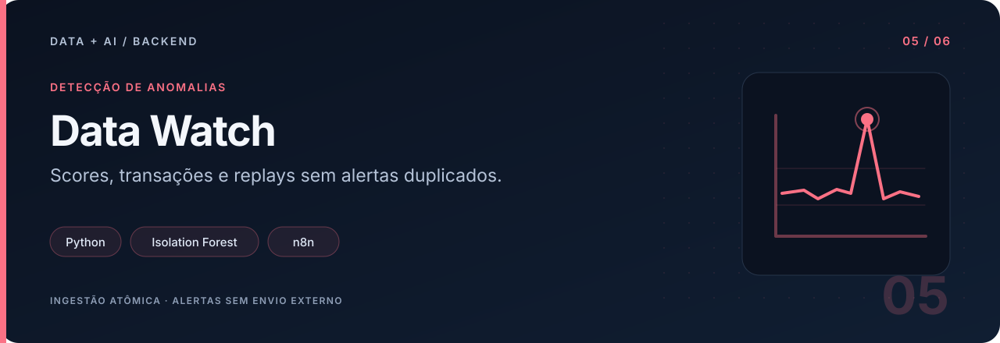
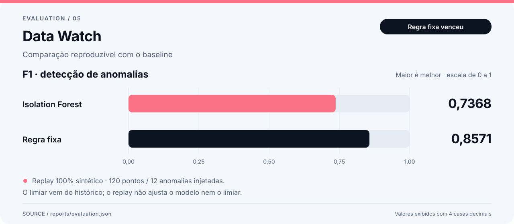
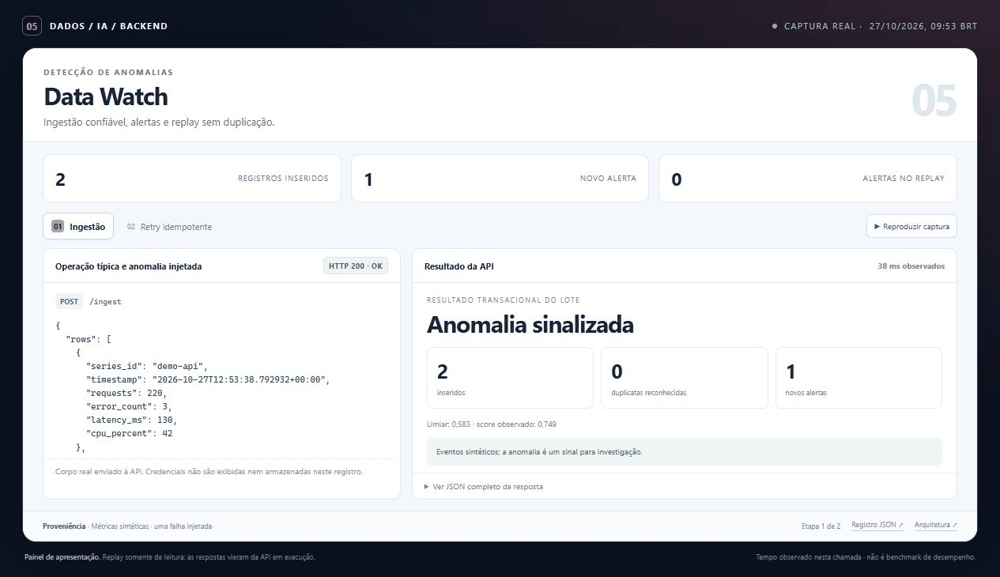
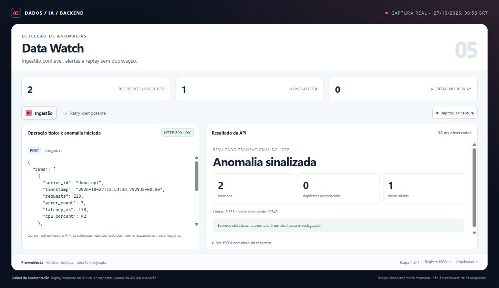
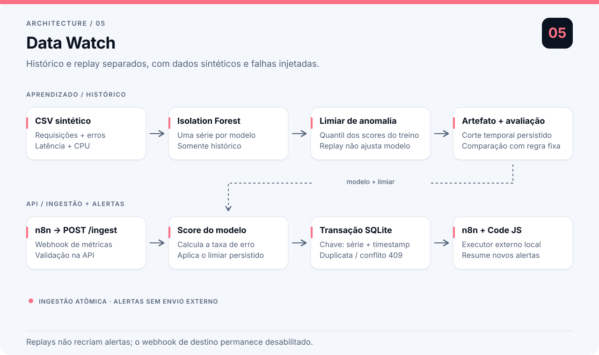

# Data Watch

Um ponto de métricas chega à API: requisições, erros, latência e CPU. O serviço verifica se a combinação é incomum para o detector treinado, registra o evento e devolve as novas anomalias.

O detector de aprendizado de máquina usa **Isolation Forest**, treinado sobre um histórico sintético de métricas. FastAPI e SQLite cuidam da ingestão e da persistência; um fluxo n8n pode receber os lotes, e retries idênticos não criam alertas duplicados.

> No replay sintético registrado, regras fixas detectaram mais falhas do que o modelo. Os dois resultados estão disponíveis para comparação.

## O detector em números



F1 no replay sintético com 12 falhas injetadas. Neste experimento, o baseline de regras superou o modelo.

O treino utiliza os primeiros **600 pontos**. O replay contém os **120 pontos posteriores**, sendo **12 falhas injetadas**. O limiar é o quantil 0,98 dos scores no histórico, definido antes de avaliar o replay. Os rótulos `is_anomaly` nunca entram no treinamento ou na matriz de features.

Resultados de [reports/evaluation.json](reports/evaluation.json):

| Detector | Precisão | Recall | F1 | Falhas detectadas |
|---|---:|---:|---:|---:|
| Isolation Forest | 1,0000 | 0,5833 | 0,7368 | 7 de 12 |
| Regras fixas | 1,0000 | 0,7500 | 0,8571 | 9 de 12 |

**O baseline foi melhor neste replay.** Ele verifica latência acima de 300 ms, erro acima de 10% ou CPU acima de 90%. As falhas geradas são simples e favorecem regras. Isolation Forest deixou cinco falhas passarem; não ajustamos o limiar usando o holdout para esconder esse resultado. Ambas as abordagens tiveram zero falso positivo nestes 108 pontos normais, uma amostra pequena demais para estimar a taxa real.

O relatório inclui scores por evento, tipo da falha injetada, confusão, hashes dos CSVs e versão do modelo. Esses números demonstram uma comparação reproduzível, **não eficácia em operação real**. `score` é uma medida de anomalia, não uma probabilidade de incidente.

## Exemplo de ingestão

O replay envia um ponto típico e outro com falha extrema injetada. Reenviar o lote demonstra que os mesmos eventos não geram alertas duplicados.



[Abrir a demonstração](docs/demo/index.html) · [Dados da execução](docs/demo/run.json) · [Chamada adicional no Swagger](docs/assets/api-docs.jpg)

<details><summary>Ver o painel estático</summary>



</details>

## Contrato da API

| Rota | Comportamento |
|---|---|
| `GET /health` | 200 com modelo carregado; 503 se ausente |
| `GET /model` | Features, janela de treino, limiar, seed e versão |
| `POST /ingest` | Até 1.000 linhas por lote; retorna inseridos, duplicatas e novas anomalias |
| `GET /anomalies?limit=100&offset=0` | Lista paginada, das anomalias mais recentes para as mais antigas |

Cada linha tem `series_id`, `timestamp` com timezone, `requests`, `error_count`, `latency_ms` e `cpu_percent`. Requisições devem ser inteiras e positivas, erros não podem ultrapassar requisições, CPU fica entre 0 e 100 e floats devem ser finitos. O timestamp é normalizado para UTC. Este modelo atende **uma série por vez**; pontos de outra série ou anteriores/iguais ao último ponto de treino retornam 422.

A chave é `(series_id, timestamp)`. O mesmo conteúdo nessa chave é uma duplicata aceita; conteúdo diferente retorna 409. O lote inteiro é atômico: um conflito desfaz inclusive as linhas anteriores do lote. SQLite usa transação de escrita, WAL, índice para consulta de anomalias e conexões curtas. Retries concorrentes da mesma carga são testados.

`var/metrics.sqlite3` guarda os dados, scores e versão responsável por cada resultado. `var/` é ignorado pelo Git. `DATA_WATCH_DB_PATH` e `DATA_WATCH_MODEL_PATH` alteram os caminhos da API; exemplos estão em `.env.example`, que não é carregado automaticamente. Os comandos CLI usam seus próprios argumentos `--db` e `--model`.

## Executar

Requer Python 3.11 ou superior. Execute neste diretório:

```powershell
python -m venv .venv
.\.venv\Scripts\Activate.ps1
python -m pip install -r requirements.lock
python -m pip install --no-deps -e .
python -m data_watch train
python -m data_watch evaluate
python -m data_watch replay
python -m data_watch replay
```

Em macOS/Linux, a ativação é `source .venv/bin/activate`; os outros comandos são iguais. `requirements.lock` registra versões exatas da execução. Uma instalação flexível para desenvolvimento é `python -m pip install -e '.[dev]'`; reavalie depois de atualizar dependências.

O primeiro replay grava 120 pontos. O segundo retorna 120 duplicatas e zero novas anomalias. Um replay nunca substitui silenciosamente um ponto existente. Para começar outra demonstração, escolha outro arquivo: `python -m data_watch replay --db var/another-demo.sqlite3`.

Para usar HTTP:

```powershell
python -m uvicorn data_watch.api:app --host 127.0.0.1 --port 8005
```

Abra <http://127.0.0.1:8005/docs>. Exemplo de ponto futuro com alterações artificiais fortes:

```powershell
$row = @{series_id='demo-api'; timestamp='2025-01-04T00:00:00Z'; requests=900; error_count=300; latency_ms=850; cpu_percent=99}
$body = @{rows=@($row)} | ConvertTo-Json -Depth 3
Invoke-RestMethod http://127.0.0.1:8005/ingest -Method Post -ContentType 'application/json' -Body $body
Invoke-RestMethod 'http://127.0.0.1:8005/anomalies?limit=10'
```

Em Unix:

```bash
curl -X POST http://127.0.0.1:8005/ingest \
  -H 'Content-Type: application/json' \
  -d '{"rows":[{"series_id":"demo-api","timestamp":"2025-01-04T00:00:00Z","requests":900,"error_count":300,"latency_ms":850,"cpu_percent":99}]}'
```

## CSV e n8n

`python -m data_watch replay --csv caminho.csv` valida o CSV inteiro antes da transação. Metadados sintéticos `is_anomaly`, `anomaly_kind` e `source` não são enviados ao modelo. Treinar exige pelo menos 100 pontos e rejeita chaves duplicadas. Avaliar exige rótulos 0/1 e uma janela estritamente posterior ao treino.

Importe [n8n/data-watch.json](n8n/data-watch.json), de ID `portfolioWatch05`. O Webhook recebe `{"rows":[...]}`, chama a API pelo DNS Compose `http://data-watch:8005/ingest` e usa JavaScript para resumir novas anomalias. `Respond to Webhook` preserva os códigos 409/422. O arquivo vem **inativo**, sem credenciais ou envio externo.

O último HTTP Request continua **desabilitado** e aponta a um receptor local de exemplo não incluído no projeto. O filtro anterior só encaminha lotes bem-sucedidos com novos alertas. A resposta ao solicitante confirma a ingestão, não a entrega de uma notificação. Veja mounts, task runner, publicação e configuração do destino no [guia da integração](n8n/README.md).

O teste `python n8n/verify_webhook.py --report n8n/validation.json` atravessa n8n e API por HTTP real: insere um ponto sintético extremo, verifica alerta, repete sem gerar outro, provoca conflito 409 e entrada inválida 422. Requer os serviços rodando e o workflow publicado; não usa mocks.

Os quatro casos passaram com n8n 2.44.7, task runner JavaScript e a API em contêiner. Veja o [registro da validação](n8n/validation.json).

## Fluxo de métricas



Histórico temporal, detector congelado, ingestão atômica e alertas de novos pontos via integração n8n. Veja as [decisões técnicas](ARCHITECTURE.md).

## Verificar e empacotar

```powershell
pytest -q
python -m data_watch.generate --seed 42
python -m data_watch train --seed 42 --quantile 0.98
python -m data_watch evaluate
docker build -t data-watch .
docker run --rm -p 127.0.0.1:8005:8005 data-watch
```

Os testes verificam separação temporal, independência do treino em relação aos rótulos, ingestão repetida e concorrente, rollback de lote, campos inválidos, limites da API e reprodutibilidade do gerador. O Dockerfile treina no build e executa com usuário sem privilégios; sem volume, a base não sobrevive à remoção do contêiner. A imagem foi construída e a API participou da validação HTTP real no Compose do ambiente local. O GitHub Actions executa os testes automaticamente.

## Limites e evolução

O modelo congelado não aprende sazonalidade complexa, não se atualiza com ingestão e não mede drift. Atribuição da causa da falha também não faz parte da API. Pontos já ingeridos não são reavaliados automaticamente ao trocar o modelo. O limiar treinado no histórico pode ser otimista; uma próxima versão deveria usar uma janela temporal exclusiva para calibração e um teste novo, sem reutilizar este replay para escolher parâmetros.

O serviço é local e não tem autenticação ou rate limiting. Não o exponha publicamente como está. Carregue apenas artefatos joblib de origem confiável. Veja [ARCHITECTURE.md](ARCHITECTURE.md), [MODEL_CARD.md](MODEL_CARD.md) e [data/DATA_CARD.md](data/DATA_CARD.md).
