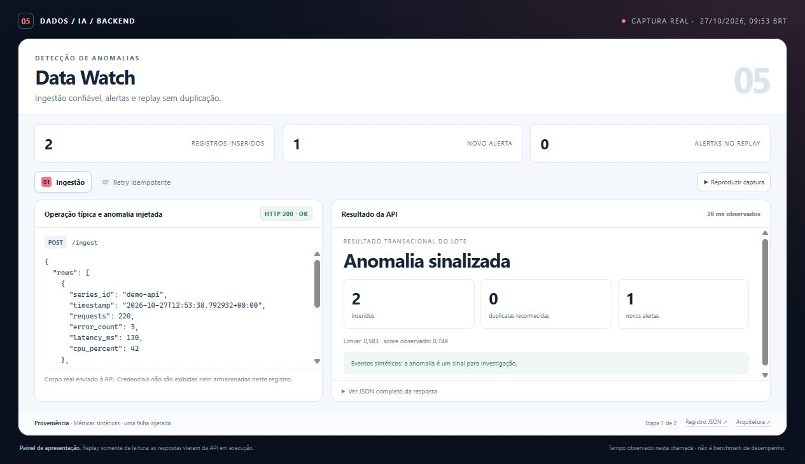
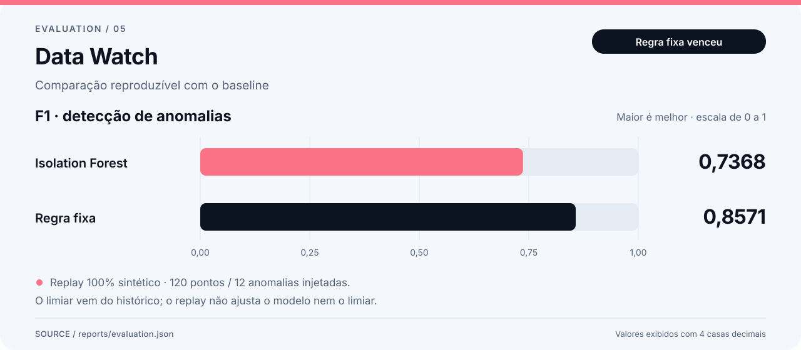

# Demonstração — Data Watch

O painel de demonstração mostra o backend por meio de respostas reais da API, coletadas em uma execução local. O screenshot e a animação são capturas desse painel renderizado no navegador.



[Ver animação](assets/demo.gif) · [Abrir o painel local](demo/index.html) · [Inspecionar o registro bruto](demo/run.json) · [Voltar ao README](../README.md)

## O que observar

- Um lote válido recebe scores, inseridos, duplicatas e novas anomalias.
- Reenviar o lote retorna duas duplicatas e zero novas anomalias.
- O relatório permite comparar o detector com limites fixos sem usar os rótulos no treino.

## Dados e evidências

O histórico e o replay são inteiramente sintéticos. As falhas foram injetadas e rotuladas para avaliar o detector; esses rótulos não entram nas features nem no ajuste do limiar. Scores não são probabilidades de incidente.

Relatório técnico complementar: [resultado registrado](../reports/evaluation.json).

`demo/run.json` conserva requests, respostas HTTP, códigos de status, duração e verificações de cada etapa. A seção `supporting_evidence` identifica os relatórios offline associados, incluindo seus hashes. Valores de avaliações anteriores continuam identificados como relatórios registrados, separados das respostas HTTP da execução capturada.



F1 no replay sintético com 12 falhas injetadas. Neste experimento, o baseline de regras superou o modelo. Fonte: [relatório registrado](../reports/evaluation.json).

## Registro da captura

| Informação | Origem |
| --- | --- |
| Início da execução, UTC | `2026-10-27T12:53:38.792932+00:00` |
| Fim da execução, UTC | `2026-10-27T12:53:38.849590+00:00` |
| Respostas e verificações | [demo/run.json](demo/run.json) |
| Painel com dados incorporados | [demo/index.html](demo/index.html) |
| Captura no navegador | [assets/screenshot.jpg](assets/screenshot.jpg) |
| Fluxo animado | [assets/demo.gif](assets/demo.gif) |
| Swagger: captura adicional independente | [assets/api-docs.jpg](assets/api-docs.jpg) |

Os timestamps acima pertencem à coleta da API. A imagem e o GIF documentam a apresentação desses dados no navegador. Abrir o HTML preserva o registro capturado; novas chamadas à API exigem o ambiente em execução.

A captura adicional do Swagger mostra uma requisição executada no navegador e sua resposta HTTP 200. Essa chamada é independente; o JSON acima corresponde à coleta usada no painel e no GIF.

## Reproduzir

Siga o setup no [README](../README.md) e execute, na raiz deste projeto:

```powershell
python -m data_watch train
python -m data_watch evaluate
python -m data_watch replay
python -m data_watch replay
python -m uvicorn data_watch.api:app --host 127.0.0.1 --port 8005
```

A API usa a porta `8005`. Os exemplos HTTP e as configurações de ambiente estão no README. O painel local pode ser aberto pelo arquivo `docs/demo/index.html`, que incorpora os dados capturados e permite percorrer as etapas sem consultar os serviços.

O screenshot facilita a leitura inicial; o JSON, os testes e os comandos permitem verificar o comportamento apresentado. Uma execução capturada documenta aquele cenário e ambiente, com os limites de dados descritos neste projeto.
